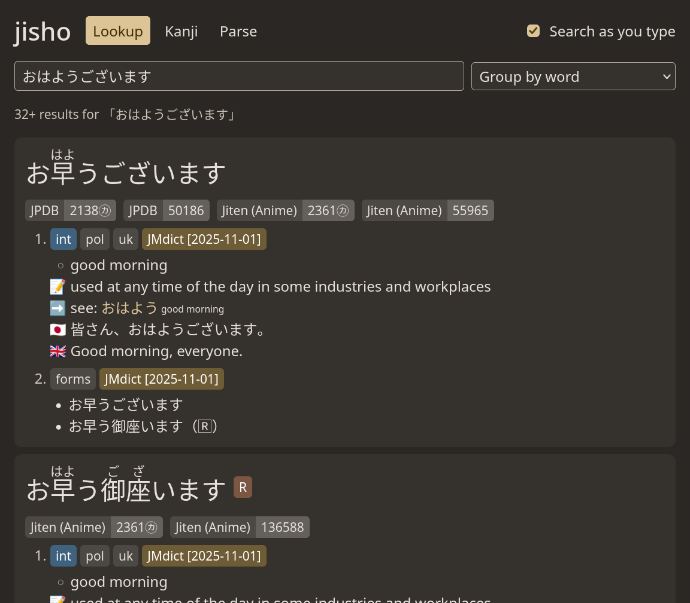
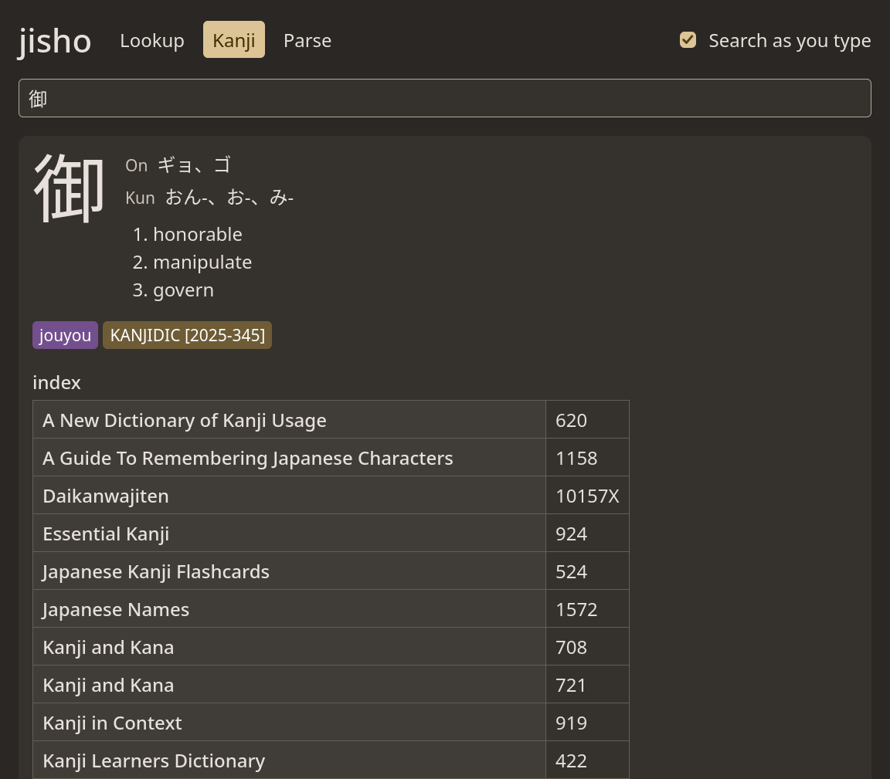
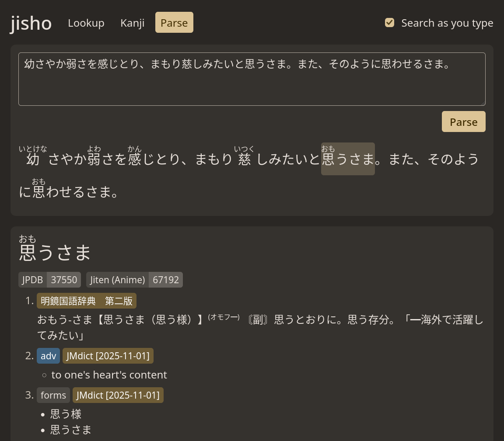

# jisho

A Japanese dictionary engine for [Rikaitan](https://github.com/Ajatt-Tools/rikaitan)/[Yomitan](https://github.com/yomidevs/yomitan) dictionaries.

| Lookup Page | Kanji Search Page | Sentence Parse Page |
|:---:|:---:|:---:|
|  |  |  |

## What it does

- **Import** dictionary zips (format 3): terms with 
  structured-content glossaries, frequencies, pitch accents, IPA, kanji,
  and tags. Dictionaries are stored compressed in **one SQLite file**.
- **Look up** the start of a text: longest match, inflections undone kana/width/romaji variants tried.
- **Group** results: by word (`group`, the default), by the
  main dictionary's entries (`merge`), by term, or one entry per
  definition (`split`), with tags, frequencies and pitch accents.
- **Kanji** readings, meanings, stats and frequencies.
- **Parse** sentences into words with furigana.
- **HTTP/JSON API** (docs/api.md), including dictionary upload, removal, order and settings, with a `--read-only` mode.
- **Web UI** in the same binary: `jisho serve` and open http://127.0.0.1:47613/ for word lookup, kanji and sentence parsing.

## Quick start

Build from source (see docs/install.md for requirements and options):

```sh
cargo build --release
cp target/release/jisho ~/.local/bin/    # or anywhere on your PATH
```

Then:

```sh
jisho import JMdict_english.zip KANJIDIC_english.zip
jisho lookup taberarenakatta     # Japanese text or romaji
jisho kanji KANJI                # e.g. a kanji character
jisho parse SENTENCE             # words with furigana
jisho lookup --result-mode merge --json iku   # the API's JSON

jisho list                       # dictionaries, in lookup order
jisho order JMdict               # put JMdict first
jisho dictionary 3 --disable     # stop using dictionary 3
jisho settings --sort-frequency JPDB --sort-frequency-order ascending
jisho remove JMdict

jisho serve                      # API and web UI on http://127.0.0.1:47613/
```

`jisho --help` and `jisho COMMAND --help` list everything.

## Documentation

- [docs/install.md](./docs/install.md): requirements, building, the store, upgrading, running
  the server, uninstalling.
- [docs/api.md](./docs/api.md): the HTTP API.
- [docs/brief.md](./docs/brief.md): what the project is and why it is built this way.
- [docs/plan](./docs/plan): milestone plans, measurements, parity results and the
  known differences from Yomitan.

## Develop

```sh
scripts/check.sh    # format, lint, tests, ASCII, license and dependency checks
jisho bench         # lookup latency on your store (bench/sentences.txt)
```

The web UI's sources are in ui/src (TypeScript, Tailwind with ponkotsu-css).
The built files in ui/dist are committed and embedded in
the binary, so building jisho needs no Node.js; after changing the UI,
rebuild them (Node.js 22 or newer):

```sh
cd ui && npm ci && npm run build
```

Fuzzing needs a nightly toolchain and cargo-fuzz (`rustup toolchain
install nightly`, `cargo install cargo-fuzz`):

```sh
python3 -I fuzz/seed.py                       # seed corpora from the fixtures
cargo +nightly fuzz run -O import -- -max_total_time=3600 -max_len=65536
```

Targets: `archive`, `rows`, `render`, `import`, `lookup` (fuzz/fuzz_targets).

Read AGENTS.md before contributing.

## License

AGPL-3.0-or-later (LICENSE). Files ported from Yomitan stay under
GPL-3.0-or-later; see NOTICE for them and for third-party data, and
docs/install.md for what to ship with a binary. If you
run a modified jisho as a network service for others, AGPL-3.0 requires
you to offer them its source: publish it and pass `--source-url` to
`jisho serve` (GET /v1/source shows it with the commit).
